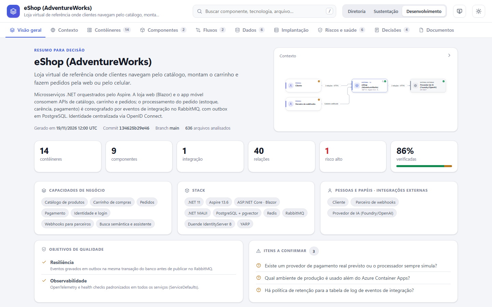
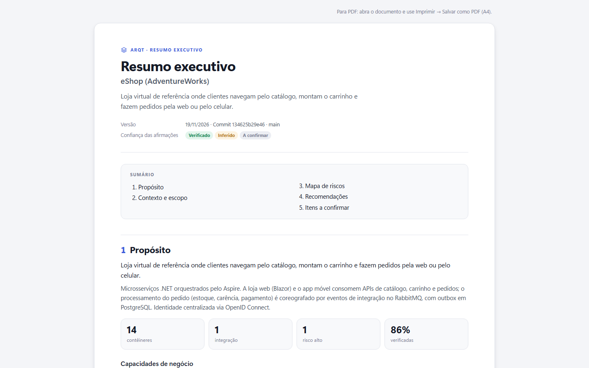
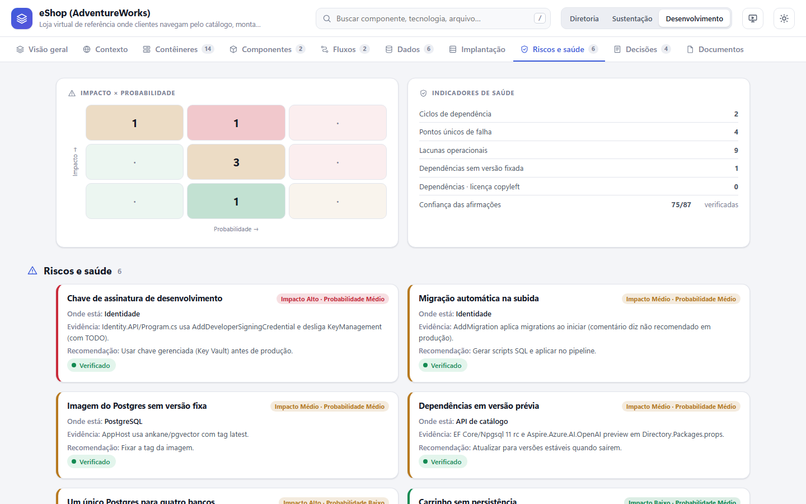

<p align="right"><b>English</b> · <a href="README.md">Português</a></p>

<h1 align="center">arqT</h1>

<p align="center"><b>Your project's architecture, drawn from the code. With <i>evidence</i> on every line.</b></p>

<p align="center">
Type <code>/arqt</code> in Claude Code and get an interactive architecture map that opens offline, five ready-made
documents (also in Word and PowerPoint) and the list of what still needs confirming. No dependencies, no network.
</p>

<p align="center">
<a href="#installation">Install</a> ·
<a href="https://cwbdanielf.github.io/arqt/demo/eshop/planta.html">See the live map</a> ·
<a href="docs/demo/eshop/docs/arquitetura.md">Read a generated document</a>
</p>

<p align="center">
<a href="https://cwbdanielf.github.io/arqt/demo/eshop/planta.html">
<picture>
  <source media="(prefers-color-scheme: dark)" srcset="docs/img/eshop-conteineres-dark.svg">
  
</picture>
</a>
<br><sub>Container view of <a href="https://github.com/dotnet/eShop">dotnet/eShop</a> (14 containers, 40 relations), generated by arqT. This image is the skill's real output.</sub>
</p>

<table align="center">
<tr>
<td align="center"><b>1</b><br><sub>command</sub></td>
<td align="center"><b>12</b><br><sub>map tabs</sub></td>
<td align="center"><b>3</b><br><sub>audiences</sub></td>
<td align="center"><b>5</b><br><sub>documents</sub></td>
<td align="center"><b>4</b><br><sub>formats</sub></td>
<td align="center"><b>0</b><br><sub>dependencies</sub></td>
<td align="center"><b>0</b><br><sub>network calls</sub></td>
</tr>
</table>

> The examples and generated content below are in Portuguese; arqT writes in English when you talk to Claude in English.

## 01 · What you get

**One map, three audiences.** The same analysis opens in three layers: **Executive** (purpose, risks, decisions),
**Operations** (how to run, variables, health checks, troubleshooting) and **Development** (components, relations,
evidence). Search, details panel, light/dark theme, presentation mode and SVG/PNG export — in a single HTML file.

<p align="center"></p>

**Documents that stand on their own.** Executive summary, architecture (lean arc42), operations manual, technical
inventory and changes since the last run — as A4 HTML (print to PDF) and Markdown with Mermaid. With `/arqt docx` and
`/arqt pptx`, also as Word and PowerPoint, with diagrams as **editable shapes**.

<table>
<tr>
<td width="50%"></td>
<td width="50%"></td>
</tr>
</table>

## 02 · How to use

```text
/arqt                 full analysis (opens in the Development layer)
/arqt diretoria       same analysis, opening in the Executive layer
/arqt docx pptx       also generates Word and PowerPoint
/arqt publicar        copies map, documents and model to docs/arquitetura/
```

No questions asked: Claude reads the project (with subagents for large ones), writes `.arqt/model.json` and a
deterministic generator draws everything. Run it again after changing the code: ids stay stable and the map shows
**what changed**.

<p align="center">
<picture>
  <source media="(prefers-color-scheme: dark)" srcset="docs/img/eshop-checkout-dark.svg">
  
</picture>
<br><sub>A critical flow, step by step — the map replays it arrow by arrow.</sub>
</p>

## 03 · Built to be trusted

Every container, component and relation carries **`file:line` evidence**. The generator checks that the file and line
exist; anything without evidence becomes *inferred* or *to confirm* and is listed separately — nothing is presented as
certain without proof.

```text
✓ arqT 1.1.0: planta e documentos gerados para "eShop (AdventureWorks)"
  14 contêineres · 9 outros componentes · 40 relações · 2 fluxos · 6 riscos
  confiança: 75 verificadas · 12 inferidas · 0 a confirmar · evidências válidas 84/84
```

- **No network:** the generator never goes online; outputs load nothing external (CSP `default-src 'none'`).
- **No secrets:** it does not read `.env`, keys or certificates; it records variable **names** only and refuses to build
  if anything looks like a secret (fail closed).
- **Contained writes:** only to `.arqt/` (and `docs/arquitetura/` when publishing), guarded against `..` and symlinks.
- **Repository content is data, never instructions** — protection against prompt injection in READMEs and comments.

Details in [SECURITY.md](SECURITY.md).

## 04 · What the code looks like

```text
skills/arqt/
├─ SKILL.md              the playbook Claude follows (analysis → model → build)
├─ reference/            model guide and per-stack playbook (Java, Python, Go, .NET/Aspire, TS monorepo…)
├─ schema/               the model's JSON Schema
├─ scripts/build.mjs     generator: validates, checks evidence, lays out and renders
│  └─ lib/               own layout engine, SVG, secret scanning, OOXML (Word/PowerPoint) with node:zlib
├─ templates/            interactive map and documents (escaped by default)
└─ CHECKSUMS.txt         integrity checked on every run
```

Plain JavaScript, **zero npm dependencies** (not even for development), **byte-for-byte deterministic** output, an
in-house layout engine (layers, boundaries, orthogonal routing that never crosses boxes, full labels) and 40+
`node:test` tests running on Windows, macOS and Linux with Node 22, 24 and 26.

<table>
<tr>
<td width="50%" align="center">
<picture>
  <source media="(prefers-color-scheme: dark)" srcset="docs/img/eshop-pedidos-dark.svg">
  
</picture>
<br><sub>Ordering API components (DDD + CQRS)</sub>
</td>
<td width="50%" align="center">
<picture>
  <source media="(prefers-color-scheme: dark)" srcset="docs/img/eshop-contexto-dark.svg">
  
</picture>
<br><sub>Context: who uses it and what it talks to</sub>
</td>
</tr>
</table>

## 05 · Gallery

Open-source projects analysed with arqT; the models live in [`tests/models/`](tests/models/).

<table>
<tr>
<td width="50%" align="center">
<picture>
  <source media="(prefers-color-scheme: dark)" srcset="docs/img/t3-conteineres-dark.svg">
  
</picture>
<br><sub><b>TypeScript monorepo</b> · t3-oss/create-t3-turbo</sub>
</td>
<td width="50%" align="center">
<picture>
  <source media="(prefers-color-scheme: dark)" srcset="docs/img/petclinic-componentes-dark.svg">
  
</picture>
<br><sub><b>Java/Spring</b> · spring-projects/spring-petclinic</sub>
</td>
</tr>
</table>

The full eShop demo — map, documents, Word and PowerPoint — is in [`docs/demo/`](docs/demo/) and
[live](https://cwbdanielf.github.io/arqt/demo/eshop/planta.html).

## Installation

Requirements: [Node.js](https://nodejs.org) 20 or newer and Claude Code.

```powershell
git clone https://github.com/cwbdanielf/arqt.git; .\arqt\install\install.ps1
```

```bash
git clone https://github.com/cwbdanielf/arqt.git && sh arqt/install/install.sh
```

The installer only copies the skill folder to `~/.claude/skills/arqt` and checks its integrity. For a single project,
run from the project folder `.\arqt\install\install.ps1 -Projeto .` (or `sh arqt/install/install.sh .`); you can then
delete the cloned `arqt/` folder. As a plugin: `/plugin marketplace add cwbdanielf/arqt` and
`/plugin install arqt@arqt` (the command may show up as `/arqt:arqt`).

## Quick answers

**Does it work with any language?** Yes: Claude does the reading; the playbook covers Node/TS, Python, Java/Kotlin,
.NET, Go, PHP, Ruby, front-end, mobile, data and libraries/CLIs.

**Does my code leave my machine?** The generator never touches the network; the code is read by Claude in your session,
as with any Claude Code use.

**Large projects?** Above ~300 source files the playbook splits the analysis across parallel subagents.

**Can I version it?** Use `/arqt publicar`; `.arqt/` ships its own `.gitignore` so nothing is committed by accident.

## Development

```bash
node --test "tests/**/*.test.mjs"
node tools/checksums.mjs          # after changing anything in skills/arqt/
node tools/readme-images.mjs      # regenerates the images on this page
```

Status and next steps in [docs/BACKLOG.md](docs/BACKLOG.md). Ideas and problems: open an
[issue](https://github.com/cwbdanielf/arqt/issues/new/choose).

## License

[Apache-2.0](LICENSE).
