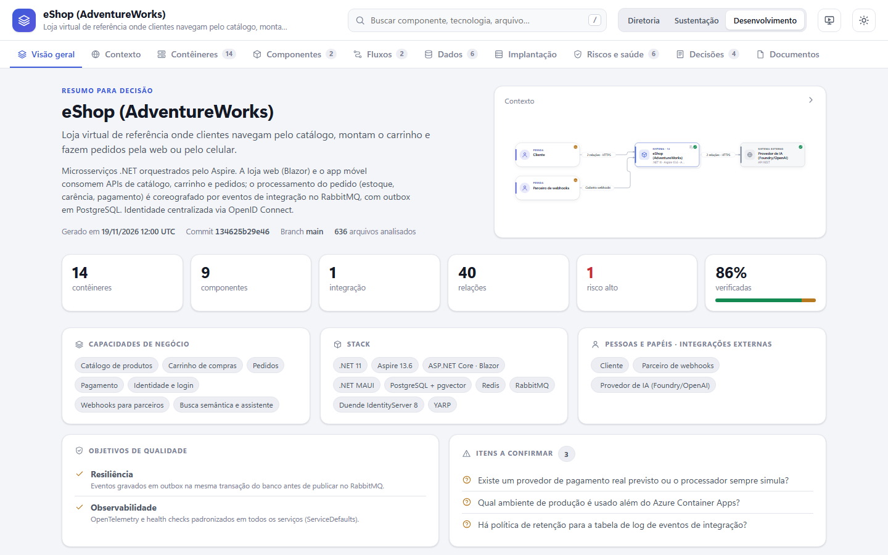
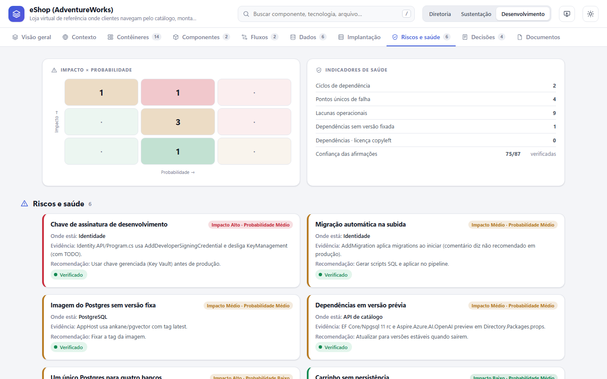

<p align="right"><a href="README.en.md">English</a> · <b>Português</b></p>

<h1 align="center">arqT</h1>

<p align="center"><b>A arquitetura do seu projeto, desenhada a partir do código. Com <i>evidência</i> em cada linha.</b></p>

<p align="center">
Digite <code>/arqt</code> no Claude Code e receba uma planta interativa que abre offline, cinco documentos prontos
(também em Word e PowerPoint) e a lista do que ainda precisa ser confirmado. Sem instalar dependências, sem rede.
</p>

<p align="center">
<a href="#instalação">Instalar</a> ·
<a href="https://cwbdanielf.github.io/arqt/demo/eshop/planta.html">Ver a planta ao vivo</a> ·
<a href="docs/demo/eshop/docs/arquitetura.md">Ler um documento gerado</a>
</p>

<p align="center">
<a href="https://cwbdanielf.github.io/arqt/demo/eshop/planta.html">
<picture>
  <source media="(prefers-color-scheme: dark)" srcset="docs/img/eshop-conteineres-dark.svg">
  
</picture>
</a>
<br><sub>Vista de contêineres do <a href="https://github.com/dotnet/eShop">dotnet/eShop</a> (14 contêineres, 40 relações), gerada pelo arqT. Esta imagem é a saída real do skill.</sub>
</p>

<table align="center">
<tr>
<td align="center"><b>1</b><br><sub>comando</sub></td>
<td align="center"><b>12</b><br><sub>abas na planta</sub></td>
<td align="center"><b>3</b><br><sub>públicos</sub></td>
<td align="center"><b>5</b><br><sub>documentos</sub></td>
<td align="center"><b>4</b><br><sub>formatos</sub></td>
<td align="center"><b>0</b><br><sub>dependências</sub></td>
<td align="center"><b>0</b><br><sub>acessos à rede</sub></td>
</tr>
</table>

## 01 · O que você recebe

**Uma planta para cada público.** A mesma análise abre em três camadas: **Diretoria** (propósito, riscos, decisões),
**Sustentação** (como subir, variáveis, health checks, diagnóstico) e **Desenvolvimento** (componentes, relações,
evidências). Busca, painel de detalhes, tema claro/escuro, modo apresentação e exportação SVG/PNG — num único HTML.

<p align="center"></p>

**Documentos que se leem sozinhos.** Resumo executivo, arquitetura (arc42 enxuto), manual de sustentação, inventário
técnico e mudanças desde a última execução — em HTML A4 (vira PDF pelo navegador) e Markdown com Mermaid. Com
`/arqt docx` e `/arqt pptx`, também em Word e PowerPoint, com os diagramas em **formas editáveis**.

<table>
<tr>
<td width="50%"></td>
<td width="50%"></td>
</tr>
</table>

## 02 · Como usar

```text
/arqt                 análise completa (abre na camada Desenvolvimento)
/arqt diretoria       mesma análise, abrindo na camada da diretoria
/arqt docx pptx       também gera Word e PowerPoint
/arqt publicar        copia planta, documentos e modelo para docs/arquitetura/
```

Sem perguntas: o Claude lê o projeto (com subagentes nos grandes), escreve `.arqt/model.json` e um gerador
determinístico desenha tudo. Rode de novo depois de mudar o código: os ids se mantêm e a planta mostra **o que mudou**.

<p align="center">
<picture>
  <source media="(prefers-color-scheme: dark)" srcset="docs/img/eshop-checkout-dark.svg">
  
</picture>
<br><sub>Fluxo crítico passo a passo — na planta ele é reproduzido seta por seta.</sub>
</p>

## 03 · Dá para confiar

Cada contêiner, componente e relação traz **evidência `arquivo:linha`**. O gerador confere se o arquivo e a linha
existem; o que não tem evidência vira *inferido* ou *a confirmar* e aparece numa lista própria — nada é vendido como
certo sem prova.

```text
✓ arqT 1.1.0: planta e documentos gerados para "eShop (AdventureWorks)"
  14 contêineres · 9 outros componentes · 40 relações · 2 fluxos · 6 riscos
  confiança: 75 verificadas · 12 inferidas · 0 a confirmar · evidências válidas 84/84
```

- **Zero rede:** o gerador não acessa a internet; a saída não carrega nada externo (CSP `default-src 'none'`).
- **Sem segredos:** não lê `.env`, chaves nem certificados; registra só **nomes** de variáveis e recusa o build se algo
  parecer segredo (falha fechada).
- **Escrita contida:** só em `.arqt/` (e `docs/arquitetura/` ao publicar), com proteção contra `..` e links simbólicos.
- **Conteúdo do repositório é dado, nunca instrução** — proteção contra prompt injection em READMEs e comentários.

Detalhes em [SECURITY.md](SECURITY.md).

## 04 · Como é o código

```text
skills/arqt/
├─ SKILL.md              roteiro que o Claude segue (análise → modelo → build)
├─ reference/            guia do modelo e playbook por stack (Java, Python, Go, .NET/Aspire, monorepo TS…)
├─ schema/               JSON Schema do modelo
├─ scripts/build.mjs     gerador: valida, confere evidências, desenha e renderiza
│  └─ lib/               layout próprio, SVG, varredura de segredos, OOXML (Word/PowerPoint) com node:zlib
├─ templates/            planta interativa e documentos (escape por padrão)
└─ CHECKSUMS.txt         integridade conferida a cada execução
```

JavaScript puro, **zero dependências npm** (nem para desenvolver), saída **byte a byte determinística**, motor de
layout próprio (camadas, fronteiras, roteamento ortogonal sem atravessar caixas, rótulos inteiros) e mais de 40 testes
`node:test` rodando em Windows, macOS e Linux com Node 22, 24 e 26.

<table>
<tr>
<td width="50%" align="center">
<picture>
  <source media="(prefers-color-scheme: dark)" srcset="docs/img/eshop-pedidos-dark.svg">
  
</picture>
<br><sub>Componentes da API de pedidos (DDD + CQRS)</sub>
</td>
<td width="50%" align="center">
<picture>
  <source media="(prefers-color-scheme: dark)" srcset="docs/img/eshop-contexto-dark.svg">
  
</picture>
<br><sub>Contexto: quem usa e com quem conversa</sub>
</td>
</tr>
</table>

## 05 · Galeria

Projetos open source analisados com o arqT; os modelos estão em [`tests/models/`](tests/models/).

<table>
<tr>
<td width="50%" align="center">
<picture>
  <source media="(prefers-color-scheme: dark)" srcset="docs/img/t3-conteineres-dark.svg">
  
</picture>
<br><sub><b>Monorepo TypeScript</b> · t3-oss/create-t3-turbo</sub>
</td>
<td width="50%" align="center">
<picture>
  <source media="(prefers-color-scheme: dark)" srcset="docs/img/petclinic-componentes-dark.svg">
  
</picture>
<br><sub><b>Java/Spring</b> · spring-projects/spring-petclinic</sub>
</td>
</tr>
</table>

A demonstração completa do eShop — planta, documentos, Word e PowerPoint — está em [`docs/demo/`](docs/demo/)
e [ao vivo](https://cwbdanielf.github.io/arqt/demo/eshop/planta.html).

## Instalação

Pré-requisito: [Node.js](https://nodejs.org) 20 ou superior e o Claude Code.

```powershell
git clone https://github.com/cwbdanielf/arqt.git; .\arqt\install\install.ps1
```

```bash
git clone https://github.com/cwbdanielf/arqt.git && sh arqt/install/install.sh
```

O instalador só copia a pasta do skill para `~/.claude/skills/arqt` e confere a integridade. Para um projeto só,
rode na pasta do projeto `.\arqt\install\install.ps1 -Projeto .` (ou `sh arqt/install/install.sh .`); depois pode
apagar a pasta `arqt/` clonada. Como plugin: `/plugin marketplace add cwbdanielf/arqt` e
`/plugin install arqt@arqt` (o comando pode aparecer como `/arqt:arqt`).

## Perguntas rápidas

**Funciona em qualquer linguagem?** Sim: o Claude faz a leitura; o playbook cobre Node/TS, Python, Java/Kotlin, .NET,
Go, PHP, Ruby, front-end, mobile, dados e bibliotecas/CLIs.

**Meu código sai da máquina?** O gerador não acessa a rede; o código é lido pelo Claude na sua sessão, como em qualquer uso do Claude Code.

**E em projetos grandes?** Acima de ~300 arquivos o roteiro divide a análise entre subagentes em paralelo.

**Posso versionar?** Use `/arqt publicar`; `.arqt/` tem `.gitignore` próprio para nada subir por acidente.

## Desenvolvimento

```bash
node --test "tests/**/*.test.mjs"
node tools/checksums.mjs          # depois de mudar algo em skills/arqt/
node tools/readme-images.mjs      # regenera as imagens desta página
```

Estado e próximos passos em [docs/BACKLOG.md](docs/BACKLOG.md). Sugestões e problemas: abra uma
[issue](https://github.com/cwbdanielf/arqt/issues/new/choose).

## Licença

[Apache-2.0](LICENSE).
