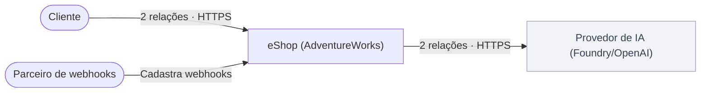
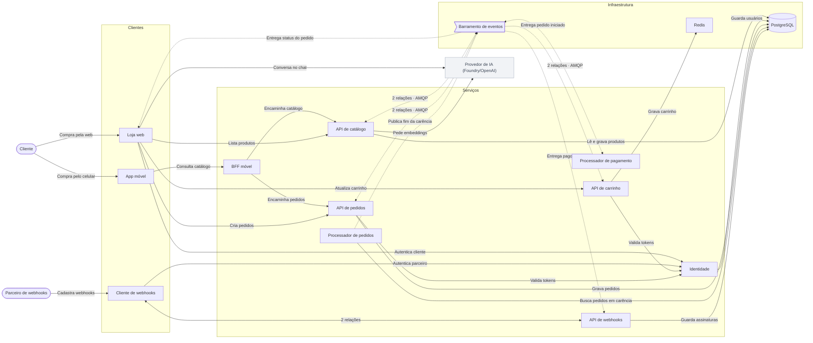
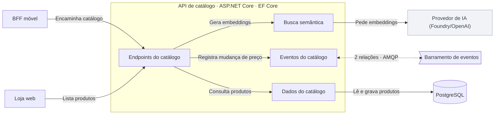
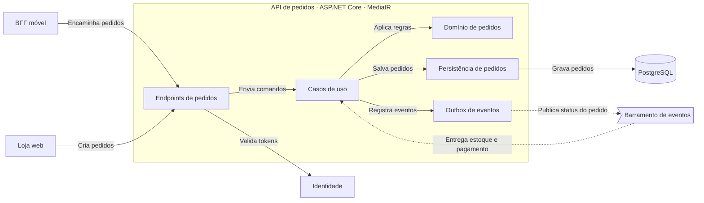
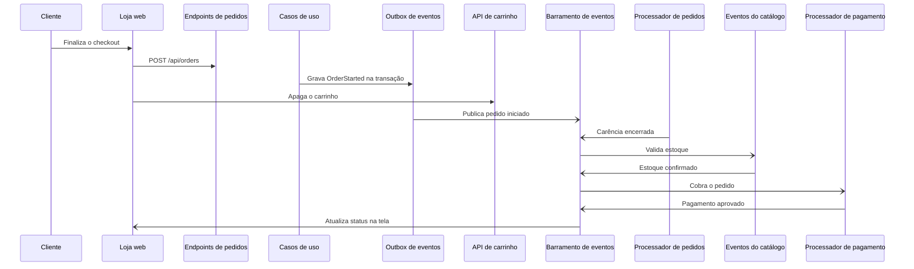
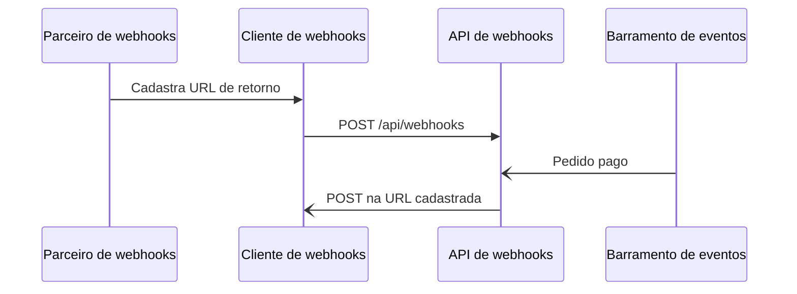

# Documento de arquitetura — eShop (AdventureWorks)

> Loja virtual de referência onde clientes navegam pelo catálogo, montam o carrinho e fazem pedidos pela web ou pelo celular.

*Versão: 19/11/2026 · Commit `134625b29e46` · Confiança das afirmações: ✓ Verificado · ~ Inferido · ? A confirmar*

## Sumário

1. Introdução e objetivos
2. Restrições
3. Contexto e escopo
4. Visão de blocos
5. Visão de execução
6. Visão de implantação
7. Dados
8. Decisões arquiteturais
9. Qualidade e indicadores
10. Riscos e dívidas técnicas
11. Glossário
12. Itens a confirmar

## 1. Introdução e objetivos

Loja virtual de referência onde clientes navegam pelo catálogo, montam o carrinho e fazem pedidos pela web ou pelo celular.

Microsserviços .NET orquestrados pelo Aspire. A loja web (Blazor) e o app móvel consomem APIs de catálogo, carrinho e pedidos; o processamento do pedido (estoque, carência, pagamento) é coreografado por eventos de integração no RabbitMQ, com outbox em PostgreSQL. Identidade centralizada via OpenID Connect.

- Catálogo de produtos
- Carrinho de compras
- Pedidos
- Pagamento
- Identidade e login
- Webhooks para parceiros
- Busca semântica e assistente

| Nome | Descrição | Confiança das afirmações |
| --- | --- | --- |
| **Resiliência** | Eventos gravados em outbox na mesma transação do banco antes de publicar no RabbitMQ. | ✓ |
| **Observabilidade** | OpenTelemetry e health checks padronizados em todos os serviços (ServiceDefaults). | ~ |

## 2. Restrições

| Tipo | Descrição | Confiança das afirmações |
| --- | --- | --- |
| technical | SDK .NET 11 (global.json) e Aspire CLI com Docker ou Podman para rodar localmente. | ✓ |
| technical | PostgreSQL precisa da extensão pgvector (imagem ankane/pgvector). | ✓ |

## 3. Contexto e escopo

| Nome | Tipo | O que é | Confiança das afirmações |
| --- | --- | --- | --- |
| **Cliente** | Pessoa | Navega no catálogo, compra e acompanha pedidos. | ~ |
| **Parceiro de webhooks** | Pessoa | Assina notificações de pedidos pagos e enviados. | ~ |
| **Provedor de IA (Foundry/OpenAI)** | Sistema externo | Modelos de chat e de embeddings; opcional, ligado por configuração. | ✓ |

## 4. Visão de blocos

| Nome | Tipo | Tecnologia | Responsabilidade | Confiança das afirmações |
| --- | --- | --- | --- | --- |
| **Loja web** | Interface | Blazor Server | Vitrine, carrinho, checkout, histórico de pedidos e assistente de compras para o cliente. | ✓ |
| **App móvel** | Interface | .NET MAUI | Apps Android, iOS e desktop (nativo e híbrido) que consultam catálogo e pedidos pelo BFF. | ✓ |
| **Cliente de webhooks** | Interface | Blazor Server | App de exemplo para parceiros cadastrarem webhooks e receberem notificações. | ✓ |
| **BFF móvel** | Gateway | YARP | Proxy reverso que expõe ao app móvel só as rotas de catálogo, pedidos e identidade. | ✓ |
| **Identidade** | Serviço | Duende IdentityServer 8 | Login, cadastro de usuários e emissão de tokens OpenID Connect para apps e APIs. | ✓ |
| **API de catálogo** | Serviço | ASP.NET Core · EF Core | Produtos, marcas, tipos, fotos e busca semântica; valida estoque dos pedidos. | ✓ |
| **API de carrinho** | Serviço | ASP.NET Core · gRPC | Guarda o carrinho de cada cliente e o apaga quando o pedido começa. | ✓ |
| **API de pedidos** | Serviço | ASP.NET Core · MediatR | Cria, cancela e envia pedidos; mantém o ciclo de vida do pedido (DDD + CQRS). | ✓ |
| **Processador de pedidos** | Job / worker | .NET BackgroundService | Encerra o período de carência dos pedidos novos e avisa que podem seguir. | ✓ |
| **Processador de pagamento** | Job / worker | .NET · consumidor | Simula o pagamento dos pedidos com estoque confirmado e publica o resultado. | ✓ |
| **API de webhooks** | Serviço | ASP.NET Core · EF Core | Cadastra assinaturas de webhooks e notifica parceiros sobre preço, pagamento e envio. | ✓ |
| **PostgreSQL** | Banco de dados | PostgreSQL · pgvector | Quatro bancos: catálogo (com vetores), identidade, pedidos e webhooks. | ✓ |
| **Redis** | Cache | Redis | Armazena os carrinhos dos clientes como JSON por comprador. | ✓ |
| **Barramento de eventos** | Fila / mensageria | RabbitMQ | Distribui eventos de integração entre os serviços (pedido iniciado, estoque, pagamento…). | ✓ |

### API de catálogo

Produtos, marcas, tipos, fotos e busca semântica; valida estoque dos pedidos.

| Nome | Tipo | Tecnologia | Responsabilidade | Confiança das afirmações |
| --- | --- | --- | --- | --- |
| **Endpoints do catálogo** | Serviço |  | Rotas REST versionadas (v1/v2) de consulta, cadastro e fotos de produtos. | ✓ |
| **Busca semântica** | Serviço |  | Gera embeddings dos produtos para busca por relevância. | ✓ |
| **Eventos do catálogo** | Serviço |  | Grava e publica mudança de preço e resultado da validação de estoque. | ✓ |
| **Dados do catálogo** | Biblioteca |  | Contexto EF Core com produtos, marcas, tipos e vetores pgvector. | ✓ |

### API de pedidos

Cria, cancela e envia pedidos; mantém o ciclo de vida do pedido (DDD + CQRS).

| Nome | Tipo | Tecnologia | Responsabilidade | Confiança das afirmações |
| --- | --- | --- | --- | --- |
| **Endpoints de pedidos** | Serviço |  | Rotas REST autenticadas para criar, cancelar, enviar e consultar pedidos. | ✓ |
| **Casos de uso** | Serviço |  | Comandos e consultas via MediatR, com validação e idempotência. | ✓ |
| **Domínio de pedidos** | Biblioteca | Ordering.Domain | Agregados Pedido e Comprador com regras de status e eventos de domínio. | ✓ |
| **Persistência de pedidos** | Biblioteca | Ordering.Infrastructure | Contexto EF Core, repositórios e unidade de trabalho do banco de pedidos. | ✓ |
| **Outbox de eventos** | Biblioteca | IntegrationEventLogEF | Grava eventos de integração na transação e publica os pendentes no barramento. | ✓ |

## 5. Visão de execução

### Compra pela loja web (✓)

Do carrinho ao pedido pago, coreografado por eventos.

### Notificação a parceiro (✓)

Parceiro recebe aviso quando um pedido é pago.

## 6. Visão de implantação

### Azure Container Apps (~)

O AppHost do Aspire publica cada projeto e recurso como contêiner num ambiente ACA.

| Nome | Tipo | Hospeda |
| --- | --- | --- |
| **Container Apps (serviços)** | container | Loja web, Cliente de webhooks, BFF móvel, Identidade, API de catálogo, API de carrinho, API de pedidos, Processador de pedidos, Processador de pagamento, API de webhooks |
| **Contêineres de infraestrutura** | container | PostgreSQL, Redis, Barramento de eventos |

## 7. Dados

| Nome | Armazenado em | Campos | Confiança das afirmações |
| --- | --- | --- | --- |
| **Produto** | PostgreSQL | Name, Price, AvailableStock, CatalogBrand, CatalogType, Embedding | ✓ |
| **Pedido** | PostgreSQL | OrderStatus, Address, OrderItems, BuyerId, PaymentId | ✓ |
| **Comprador** | PostgreSQL | IdentityGuid, Name, PaymentMethods | ✓ |
| **Carrinho** | Redis | BuyerId, Items | ✓ |
| **Usuário** | PostgreSQL | UserName, Email, Endereço, Cartão | ✓ |
| **Assinatura de webhook** | PostgreSQL | Type, DestUrl, Token, UserId | ✓ |

## 8. Decisões arquiteturais

> ADRs inferidos a partir do código — confirme com o time antes de tratá-los como oficiais.

### ADR-1 · Orquestração local e deploy com Aspire (✓)
- **Contexto:** Muitos serviços e recursos para subir juntos.
- **Decisão:** Um AppHost declara serviços, bancos, fila e referências entre eles.
- **Consequências:** Sobe tudo com um comando; o deploy fica atrelado ao modelo do Aspire.

### ADR-2 · Coreografia por eventos com outbox (✓)
- **Contexto:** Pedido envolve estoque, pagamento e notificação em serviços diferentes.
- **Decisão:** Eventos de integração no RabbitMQ, gravados antes num log transacional.
- **Consequências:** Consistência eventual; exige monitorar eventos pendentes.

### ADR-3 · DDD e CQRS no serviço de pedidos (✓)
- **Contexto:** Regras de status do pedido são as mais complexas.
- **Decisão:** Domínio separado (Ordering.Domain), comandos via MediatR e consultas diretas.
- **Consequências:** Mais camadas, porém regras isoladas e testáveis.

### ADR-4 · Carrinho em Redis via gRPC (~)
- **Contexto:** Carrinho muda muito e é por usuário.
- **Decisão:** Basket.API expõe gRPC e grava JSON no Redis.
- **Consequências:** Rápido, mas sem durabilidade garantida.

## 9. Qualidade e indicadores

| Indicadores de saúde |  |
| --- | --- |
| Ciclos de dependência | API de webhooks ⇄ Cliente de webhooks; API de catálogo ⇄ Barramento de eventos ⇄ API de pedidos ⇄ Processador de pagamento ⇄ Loja web |
| Pontos únicos de falha | API de carrinho, Barramento de eventos, Cliente de webhooks, PostgreSQL |
| Mais dependidos (fan-in) | PostgreSQL (5), Barramento de eventos (4), Identidade (4), API de catálogo (3), API de pedidos (3), API de carrinho (2) |
| Lacunas operacionais | Cliente de webhooks: sem testes detectados; BFF móvel: sem health check, sem logs definidos; Identidade: sem logs definidos, sem testes detectados; API de catálogo: sem logs definidos; API de carrinho: sem health check, sem logs definidos; API de pedidos: sem logs definidos; Processador de pedidos: sem logs definidos, sem testes detectados; Processador de pagamento: sem logs definidos, sem testes detectados; API de webhooks: sem logs definidos |
| Confiança das afirmações | 75 ✓ · 12 ~ · 0 ? |

## 10. Riscos e dívidas técnicas

- **Chave de assinatura de desenvolvimento** (Impacto Alto, Probabilidade Médio, ✓) — Usar chave gerenciada (Key Vault) antes de produção.
- **Migração automática na subida** (Impacto Médio, Probabilidade Médio, ✓) — Gerar scripts SQL e aplicar no pipeline.
- **Imagem do Postgres sem versão fixa** (Impacto Médio, Probabilidade Médio, ✓) — Fixar a tag da imagem.
- **Dependências em versão prévia** (Impacto Médio, Probabilidade Médio, ✓) — Atualizar para versões estáveis quando saírem.
- **Um único Postgres para quatro bancos** (Impacto Alto, Probabilidade Baixo, ✓) — Separar ou usar serviço gerenciado com alta disponibilidade.
- **Carrinho sem persistência** (Impacto Baixo, Probabilidade Médio, ~) — Ativar persistência ou aceitar perda de carrinhos.

## 11. Glossário

| Nome | Descrição |
| --- | --- |
| **AppHost** | Projeto do Aspire que declara e sobe todos os serviços e recursos. |
| **Evento de integração** | Mensagem publicada no RabbitMQ para avisar outros serviços de uma mudança. |
| **Outbox** | Tabela onde o evento é gravado junto com a transação antes de ser publicado. |
| **Período de carência** | Tempo após o pedido em que o cliente ainda pode cancelar antes da validação de estoque. |
| **BFF** | Back-end for front-end: proxy dedicado ao app móvel. |
| **Busca semântica** | Busca por significado usando embeddings guardados no pgvector. |

## 12. Itens a confirmar

- [ ] ADR-4: Carrinho em Redis via gRPC
- [ ] Existe um provedor de pagamento real previsto ou o processador sempre simula?
- [ ] Qual ambiente de produção é usado além do Azure Container Apps?
- [ ] Há política de retenção para a tabela de log de eventos de integração?

---
*Gerado pelo arqT a partir do código-fonte. Afirmações marcadas como inferidas ou a confirmar devem ser revisadas.*
