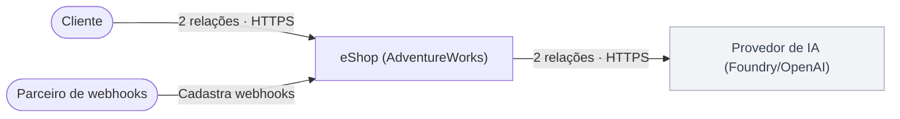

# Resumo executivo — eShop (AdventureWorks)

> Loja virtual de referência onde clientes navegam pelo catálogo, montam o carrinho e fazem pedidos pela web ou pelo celular.

*Versão: 19/11/2026 · Commit `134625b29e46` · Confiança das afirmações: ✓ Verificado · ~ Inferido · ? A confirmar*

## Sumário

1. Propósito
2. Contexto e escopo
3. Mapa de riscos
4. Recomendações
5. Itens a confirmar

## 1. Propósito

Loja virtual de referência onde clientes navegam pelo catálogo, montam o carrinho e fazem pedidos pela web ou pelo celular.

Microsserviços .NET orquestrados pelo Aspire. A loja web (Blazor) e o app móvel consomem APIs de catálogo, carrinho e pedidos; o processamento do pedido (estoque, carência, pagamento) é coreografado por eventos de integração no RabbitMQ, com outbox em PostgreSQL. Identidade centralizada via OpenID Connect.

**14** contêineres · **1** integração · **1** risco alto

**Capacidades de negócio:** Catálogo de produtos, Carrinho de compras, Pedidos, Pagamento, Identidade e login, Webhooks para parceiros, Busca semântica e assistente

**Stack:** .NET 11, Aspire 13.6, ASP.NET Core · Blazor, .NET MAUI, PostgreSQL + pgvector, Redis, RabbitMQ, Duende IdentityServer 8, YARP

## 2. Contexto e escopo

| Nome | O que é | Descrição | Confiança das afirmações |
| --- | --- | --- | --- |
| **Provedor de IA (Foundry/OpenAI)** | Modelos de chat e de embeddings; opcional, ligado por configuração. | Conversa no chat; Pede embeddings | ✓ |

## 3. Mapa de riscos

| Nome | Impacto | Probabilidade | Onde | Confiança das afirmações |
| --- | --- | --- | --- | --- |
| Chave de assinatura de desenvolvimento | Alto | Médio | Identidade | ✓ |
| Migração automática na subida | Médio | Médio | Identidade | ✓ |
| Imagem do Postgres sem versão fixa | Médio | Médio | PostgreSQL | ✓ |
| Dependências em versão prévia | Médio | Médio | API de catálogo | ✓ |
| Um único Postgres para quatro bancos | Alto | Baixo | PostgreSQL | ✓ |
| Carrinho sem persistência | Baixo | Médio | Redis | ~ |

## 4. Recomendações

1. **Usar chave gerenciada (Key Vault) antes de produção.** (Chave de assinatura de desenvolvimento)
2. **Gerar scripts SQL e aplicar no pipeline.** (Migração automática na subida)
3. **Fixar a tag da imagem.** (Imagem do Postgres sem versão fixa)
4. **Atualizar para versões estáveis quando saírem.** (Dependências em versão prévia)
5. **Separar ou usar serviço gerenciado com alta disponibilidade.** (Um único Postgres para quatro bancos)
6. **Ativar persistência ou aceitar perda de carrinhos.** (Carrinho sem persistência)

## 5. Itens a confirmar

- [ ] ADR-4: Carrinho em Redis via gRPC
- [ ] Existe um provedor de pagamento real previsto ou o processador sempre simula?
- [ ] Qual ambiente de produção é usado além do Azure Container Apps?
- [ ] Há política de retenção para a tabela de log de eventos de integração?

---
*Gerado pelo arqT a partir do código-fonte. Afirmações marcadas como inferidas ou a confirmar devem ser revisadas.*
